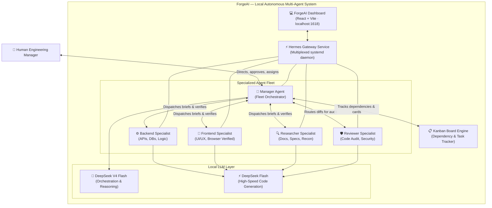

# ForgeAI ⚒️

> **A locally-run, autonomous multi-agent AI engineering system where specialized agents collaborate on complex software workflows, orchestrated by a human manager through a Kanban-driven protocol.**

[](LICENSE)
[](https://github.com/Sudhanshunaik/ForegeAI)
[](#core-principles)
[](#local-llm-layer)
[](#web-dashboard--tui)

---

## 📌 Table of Contents

- [Overview](#overview)
- [Core Principles](#core-principles)
- [System Architecture](#system-architecture)
- [Agent Fleet](#agent-fleet)
- [Kanban-Driven Orchestration](#kanban-driven-orchestration)
- [Live Demo Applications](#live-demo-applications)
- [Web Dashboard & TUI](#web-dashboard--tui)
- [Getting Started](#getting-started)
  - [Prerequisites](#prerequisites)
  - [Installation](#installation)
  - [Configuring Local LLMs](#configuring-local-llms)
  - [Setting Up Agent Profiles](#setting-up-agent-profiles)
  - [Starting the Gateway & Dashboard](#starting-the-gateway--dashboard)
- [Example End-to-End Workflow](#example-end-to-end-workflow)
- [Dispatch Protocol](#dispatch-protocol)
- [Repository Structure](#repository-structure)
- [Tech Stack](#tech-stack)
- [License](#license)

---

## Overview

**ForgeAI** transforms a developer's workstation into an autonomous, locally-hosted software engineering team. Rather than relying on a single, monolithic AI assistant that attempts to do everything, ForgeAI deploys a **fleet of specialized autonomous agents**—each with dedicated domain boundaries, tailored system prompts (SOULs), and strict output contracts.

The **human developer acts as the engineering manager / coordinator**: defining high-level goals, guiding architectural decisions, and evaluating results, while the autonomous agent fleet handles end-to-end implementation, code review, documentation research, and browser verification.

All agents, tools, databases, and LLM inferences execute **100% locally on your own machine**—ensuring absolute privacy, zero cloud API fees, and deterministic offline reliability.

---

## Core Principles

| Principle | Description |
|---|---|
| 🔒 **100% Local Sovereignty** | All LLM inference, agent runtimes, vector search, and state databases live on your machine. Zero cloud dependency and zero telemetry leakage. |
| 🧑‍💼 **Human-as-Manager** | The human leads strategy, architecture, and final approval. Agents never guess on ambiguities—they request clarification. |
| 🎯 **Strict Specialization** | Agents own concrete domains (Backend, Frontend, Research, Review, Management). Separation of concerns prevents domain pollution and increases code quality. |
| 📋 **Kanban-Driven Lifecycle** | Any multi-agent or cross-domain work strictly requires a dedicated Kanban board for transparent dependency tracking and accountability. |
| 🔍 **Evidence-Based Delivery** | Agents never assert "it works" without proof. Every delivery requires verified terminal output, test results, or live browser inspection logs. |

---

## System Architecture



A vector and preview diagram of the architecture is available at [`hermes-agent-architecture.svg`](hermes-agent-architecture.svg) and editable in [`hermes-agent-architecture.excalidraw`](hermes-agent-architecture.excalidraw).

---

## Agent Fleet

ForgeAI includes **5 purpose-built agent profiles**, each configured with isolated state, tailored system instructions, and specialized tooling:

### 🎯 1. Manager — Fleet Orchestrator
- **Profile:** `manager` | **Model:** DeepSeek V4 Flash
- **Domain:** Problem decomposition, Kanban card creation, brief dispatching, cross-agent coordination, deliverable verification.
- **Rules:**
  - Decomposes complex objectives into atomic, testable deliverables.
  - Generates self-contained dispatch briefs for specialist agents.
  - Never fabricates output from specialists; validates diffs and command evidence before delivering to the human coordinator.

### ⚙️ 2. Backend — Server-Side Specialist
- **Profile:** `backend` | **Model:** DeepSeek Flash
- **Domain:** Server architectures, REST / GraphQL / gRPC endpoints, database schemas & migrations, transaction safety, business logic, background queues.
- **Standards:**
  - Validates schemas, parameters, and error handling for all endpoints.
  - Proves implementation correctness using unit/integration tests and real curl/HTTP execution.

### 🎨 3. Frontend — Client-Side Specialist
- **Profile:** `frontend` | **Model:** DeepSeek Flash
- **Domain:** Component architecture, modern styling, client state management, responsive layouts, accessibility (WCAG), performance.
- **Standards:**
  - Launches local dev servers and verifies rendered DOM and console logs.
  - Explicitly tests empty, loading, error, and dynamic content states.
  - Never assumes visual layout without real browser validation.

### 🔍 4. Researcher — Reconnaissance & Documentation
- **Profile:** `researcher` | **Model:** DeepSeek Flash
- **Domain:** Library evaluation, version compatibility matrices, documentation search, RFC/spec verification, codebase reconnaissance.
- **Standards:**
  - Does not modify production code.
  - Returns concise, sourced findings with clear distinctions between confirmed facts and inferences.

### 🛡️ 5. Reviewer — Code Review & Security Audit
- **Profile:** `reviewer` | **Model:** DeepSeek Flash
- **Domain:** PR diff inspection, OWASP vulnerability detection, edge case analysis, race condition discovery, lint compliance.
- **Standards:**
  - Does not modify code directly to preserve audit independence.
  - Groups findings strictly by severity (`blocking` / `major` / `minor` / `nit`) with actionable remediation suggestions.

---

## Kanban-Driven Orchestration

Multi-agent collaboration in ForgeAI is governed by an enforced rule: **ALWAYS create a new Kanban board whenever multiple agents collaborate.**

```
┌──────┐    ┌─────────────┐    ┌────────┐    ┌──────┐
│ todo │───▶│ in_progress │───▶│ review │───▶│ done │
└──────┘    └─────────────┘    └────────┘    └──────┘
```

### Core Commands

```bash
# 1. Create a dedicated task board
hermes kanban boards create auth-service

# 2. Switch active board context
hermes kanban boards switch auth-service

# 3. Create task cards with clear criteria and assignees
hermes kanban create --title "Design JWT Auth Endpoints" \
  --body "Implement POST /api/login and POST /api/register with unit tests" \
  --assignee backend

# 4. Link dependencies (frontend blocked until backend API schema is ready)
hermes kanban link <backend_card_id> <frontend_card_id>

# 5. Review board status
hermes kanban
```

---

## Live Demo Applications

ForgeAI was used end-to-end to design, engineer, and test a diverse suite of real-world applications, available under [`demo-apps/`](demo-apps/):

| Application | Stack | Highlights |
|---|---|---|
| 🛠️ **[RIGFORGE (PC Builder)](demo-apps/pc-builder/)** | React + Vite + TypeScript | 65+ PC components, real-time socket/chipset compatibility checking, power consumption estimation, and multi-tier gaming/AI performance forecasting. |
| 🌍 **[Earth 3D](demo-apps/earth-3d/)** | Three.js + WebGL | Photorealistic interactive Earth with PBR shaders, specular ocean reflections, independent cloud layer rotation, atmospheric rim scattering, and night city lights. |
| 🎯 **[NeonStrike](demo-apps/shooter-game/)** | Vanilla JS + HTML5 Canvas | Raycast 3D arena FPS engine built without external game libraries featuring bot pathfinding, multiple weapons, sprint/dash mechanics, and match flow. |
| 🕹️ **[Chomp!](demo-apps/pacman-game/)** | Vanilla JS + Canvas | Complete arcade maze-chase game featuring 4 authentic ghost AI behaviors, fruit bonuses, sound synthesizer, and swipe/keyboard controls. |
| 🛒 **[MegaCart](demo-apps/flipkart-clone/)** | HTML5 + CSS3 + JS | E-commerce shopping store with dynamic category rails, promotional carousels, responsive cart drawer, and 3-step checkout simulation. |
| 📱 **[PhoneHub](demo-apps/phone-store/)** | HTML5 + CSS3 + JS | Modern smartphone marketplace with specification filters, brand sorting, modal quick-views, and persistent cart. |
| 🌾 **[AgriFresh](demo-apps/agri-store/)** | HTML5 + CSS3 + JS | Farm-to-table agricultural collective store featuring organic produce, cold-pressed oils, unpolished grains, and recipe guides. |
| 🧥 **[Maison Rétro](demo-apps/vintage-store/)** | HTML5 + CSS3 + JS | Curated vintage fashion boutique with decade filters (70s, 80s, 90s), item condition rating, and cart flow. |
| ⚡ **[Webroot Portal](demo-apps/webroot/)** | HTML5 + CSS3 | Unified live hub exposing all showcase applications under a single cohesive dashboard. |

---

## Web Dashboard & TUI

ForgeAI provides both visual web observability and high-speed terminal interactions:

### 1. Web Dashboard (localhost:1618)
- **Built with:** React, Vite, TypeScript.
- **Theme:** Signature *ForgeAI Black* (`#000000` true dark mode).
- **Features:** Real-time multi-agent session monitoring, Kanban board visualizer, streaming tool invocation feeds, token analytics, and profile management.

### 2. Rich Terminal UI (TUI)
- Multiline input buffer, keyboard shortcuts, history navigation, and slash-command completions (`/kanban`, `/model`, `/profile`, `/status`).
- Live terminal streaming of agent thought processes and tool actions.

---

## Getting Started

### Prerequisites
- **Operating System:** Linux (Fedora, Ubuntu, Debian, Arch) or macOS / WSL2
- **Python:** 3.11+
- **Node.js:** 18+
- **Local LLM Runner:** [Ollama](https://ollama.com), [vLLM](https://github.com/vllm-project/vllm), or any OpenAI-compatible local server.

### Installation

```bash
# 1. Clone the repository
git clone https://github.com/Sudhanshunaik/ForegeAI.git
cd ForegeAI

# 2. Activate virtual environment
source .venv/bin/activate
# or install dependencies
pip install -e .
npm install
```

### Configuring Local LLMs

Ensure your local LLM server (e.g. Ollama or vLLM) is running with DeepSeek models:

```bash
# Example with Ollama:
ollama pull deepseek-coder-v2:lite
ollama pull deepseek-v2.5
```

Configure models per profile:
```bash
hermes -p manager model set deepseek-v4-flash
hermes -p backend model set deepseek-flash
hermes -p frontend model set deepseek-flash
hermes -p researcher model set deepseek-flash
hermes -p reviewer model set deepseek-flash
```

### Setting Up Agent Profiles

ForgeAI stores agent personalities in `agent-profiles/`:

```bash
# Setup profiles for the Sovereign AI Engineering Team
for role in manager tech_lead backend frontend reviewer architect security qa devops database docs performance researcher; do
  hermes profile create $role
  cp agent-profiles/$role/SOUL.md ~/.hermes/profiles/$role/SOUL.md
  cp agent-profiles/$role/profile.yaml ~/.hermes/profiles/$role/config.yaml
done
```

### Starting the Gateway & Dashboard

```bash
# Start or restart the multiplexed daemon for all profiles
hermes gateway restart --all

# Verify active profiles
hermes profile list

# Launch the ForgeAI Web Dashboard
hermes dashboard
# Dashboard available at http://localhost:1618
```

---

## Example End-to-End Workflow

Here is how a real engineering workflow runs in ForgeAI:

1. **Manager assigns high-level task:**
   ```
   "Build a responsive PC compatibility builder with wattage calculation and benchmark predictions."
   ```

2. **Manager creates a Kanban board and decomposes:**
   ```bash
   hermes kanban boards create rigforge-feature
   hermes kanban boards switch rigforge-feature
   ```
   - **Card 1:** Research hardware TDP & socket compat rules (`researcher`)
   - **Card 2:** Implement compatibility & power algorithms in TypeScript (`backend`)
   - **Card 3:** Build UI stepper, catalog, and responsive cards (`frontend`, blocked by Card 2)
   - **Card 4:** Security & performance review (`reviewer`, blocked by Card 2 & 3)

3. **Specialists execute in parallel or sequentially according to dependencies.**
4. **Manager inspects code diffs and test results, verifies browser rendering, and presents the completed product to the user.**

---

## Dispatch Protocol

Every brief dispatched by the Manager to a specialist is completely self-contained:

```text
1. GOAL         — Concrete deliverable outcome in 1-2 sentences.
2. DELIVERABLE  — Files, patches, test runs, or benchmark reports to return.
3. INPUTS       — Absolute filesystem paths, schemas, or relevant code sections.
4. CONSTRAINTS  — Languages, versions, lint rules, styling conventions.
5. EVIDENCE     — Mandatory command execution output or browser verification logs.
```

---

## Repository Structure

```
ForegeAI/
├── agent-profiles/               # 5 specialized agent personas & configurations
│   ├── manager/                 # Fleet orchestrator profile
│   ├── backend/                 # Server-side engineering profile
│   ├── frontend/                # UI/UX engineering profile
│   ├── researcher/              # Reconnaissance & doc analysis profile
│   └── reviewer/                # Code review & security audit profile
├── demo-apps/                    # Showcase applications built with ForgeAI
│   ├── pc-builder/              # RIGFORGE — React + Vite PC builder
│   ├── earth-3d/                # Three.js 3D Earth photorealistic globe
│   ├── shooter-game/            # NeonStrike — Arena raycast 3D FPS
│   ├── pacman-game/             # Chomp! — 4-ghost AI arcade maze
│   ├── flipkart-clone/          # MegaCart — Full-featured e-commerce
│   ├── phone-store/             # PhoneHub — Smartphone boutique
│   ├── agri-store/              # AgriFresh — Organic agriculture marketplace
│   ├── vintage-store/           # Maison Rétro — Vintage apparel store
│   └── webroot/                 # Unified portal serving all live apps
├── web/                          # ForgeAI Web Dashboard (React + Vite)
│   ├── src/
│   │   ├── themes/presets.ts    # "ForgeAI Black" signature theme
│   │   ├── i18n/en.ts           # Branding & localization
│   │   └── App.tsx              # Main dashboard application
│   └── index.html               # ForgeAI - Dashboard entry point
├── hermes_cli/                   # Core CLI, gateway service & Kanban engine
├── docs/                         # In-depth architectural & project documentation
│   └── forgeai_project_document.md
├── hermes-agent-architecture.svg # Visual system architecture
├── pyproject.toml                # Python package metadata & dependencies
└── package.json                  # Node.js tooling & dependencies
```

---

## Tech Stack

| Component | Technology | Description |
|---|---|---|
| **Agent Framework** | Hermes Core Agent Engine | Tool orchestration, context management, memory loops |
| **Local LLMs** | DeepSeek V4 Flash / DeepSeek Flash | Local inference with zero cloud dependencies |
| **Gateway Daemon** | Systemd Multiplexed Service | Manages simultaneous multi-profile agents |
| **Web Dashboard** | React 18, Vite, TypeScript | Modern UI with pure-black theme & real-time telemetry |
| **Task Management** | Built-in Kanban Engine | Dependency graph tracking, task cards, lifecycle states |
| **Showcase Applications** | React, Three.js, Canvas, TypeScript | Full applications developed end-to-end by ForgeAI |
| **Runtimes** | Python 3.11+, Node.js 18+ | Primary backend and frontend environments |

---

## License

This project is licensed under the [MIT License](LICENSE).
