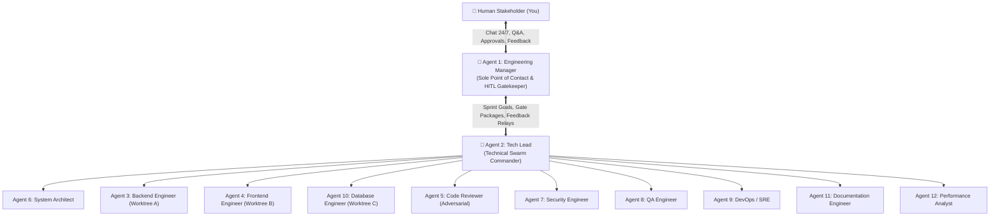
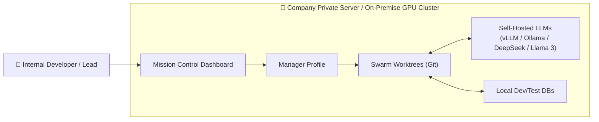
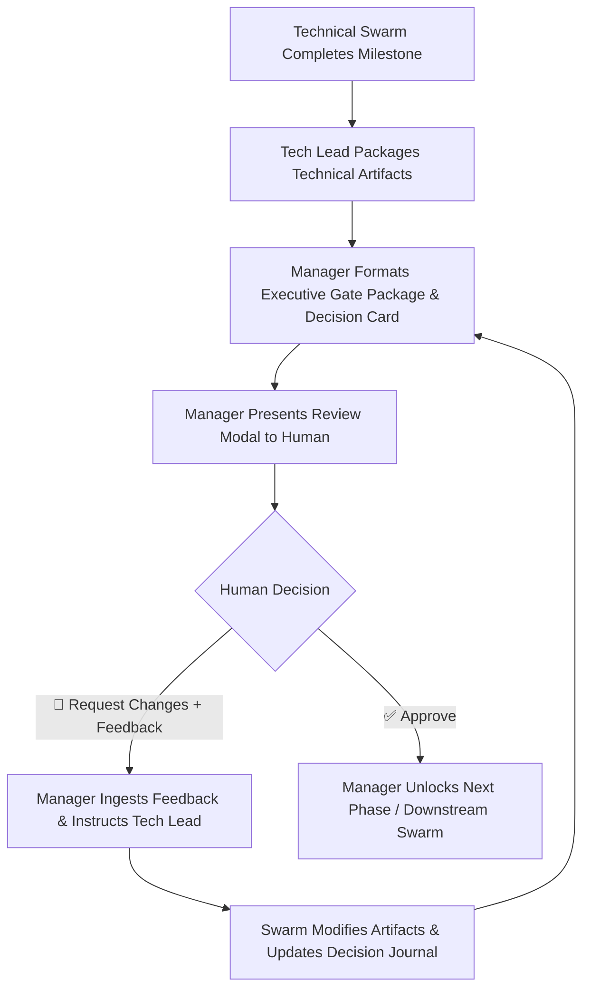

# 🎯 Agent Specifications — The Sovereign AI Engineering Team

Definitive specification for an enterprise-grade, on-premise AI software engineering department: 12 specialized agents, the Engineering Manager as the sole point of contact, parallel Git worktrees, the Decision Journal ("Why" Engine), and 5 Human-in-the-Loop Phase Gates.

---

## 🏛️ Organizational Hierarchy & Communication Topology

The engineering organization operates under a strict, clean hierarchy that insulates technical execution while giving the human complete, unbuffered access to project management and decision visibility:



### The Two Core Invariants of the Hierarchy

1. **The Sole Point of Contact Invariant:** The human interacts **exclusively with the Engineering Manager**. You never have to juggle 12 different agent channels, parse raw compiler errors, or worry about disrupting a deep execution loop. The Manager is your dedicated 24/7 liaison, answering questions, tracking progress, explaining decisions, and presenting milestones.
2. **The Buffer Invariant:** The technical team (Tech Lead, developers, reviewers) is insulated from ad-hoc interruptions. When you provide feedback or ask questions, the Manager resolves questions from shared memory or translates your requests into structured engineering tickets for the Tech Lead.

---

## 🔒 The Sovereign Enterprise Architecture (Privacy & Deployment)

Most AI coding assistants (Devin, GitHub Copilot, Cursor) require streaming proprietary source code, credentials, and business logic to third-party public cloud APIs. For regulated industries (FinTech, Healthcare, Defense, Enterprise IP), this is a non-starter.

This system is architected as **The Sovereign AI Engineering Team**:



### Dual-Mode Execution Strategy

| Feature | Enterprise Production Mode (Self-Hosted) | Demo Day / Hybrid Mode |
| :--- | :--- | :--- |
| **Model Hosting** | 100% on-premise GPU cluster / private cloud via vLLM or Ollama. | Plug-and-play public LLMs (Claude Sonnet, OpenAI o3, Gemini Flash). |
| **Data Boundary** | **Zero egress.** Code, schemas, and prompts never leave company hardware. | Lightweight hardware compatible; relies on encrypted API calls for demo. |
| **Compliance** | SOC2, HIPAA, and air-gapped network ready. | Ideal for hackathon presentations without local multi-GPU rigs. |
| **Provider Switch** | `HERMES_PROVIDER=local_vllm` in config. | `HERMES_PROVIDER=openrouter` or native provider keys. |

---

## 🖥️ Mission Control Web Dashboard & Project Showcase

To deliver an exceptional user experience without requiring developers to manage 12 CLI sessions, the system is monitored and controlled via a pre-built, dark-mode **Mission Control Web Dashboard**:

```
┌────────────────────────────────────────────────────────────────────────────────────────────────┐
│  🚀 SOVEREIGN AI ENGINEERING TEAM — MISSION CONTROL                          [Portfolio ▾] [⚙] │
├─────────────────────────┬───────────────────────────────┬──────────────────────────────────────┤
│ 💬 MANAGER CHAT (24/7)  │ ⚡ ACTIVE WORKTREES (SWARM)    │ 🛡️ GATE INSPECTOR & DECISION JOURNAL │
├─────────────────────────┼───────────────────────────────┼──────────────────────────────────────┤
│ Human: "Build Team      │ 🌿 worktree/backend-invites   │ 🛑 PHASE GATE 3: VISUAL REVIEW       │
│ Invite & Role Modal"    │    [Active] POST /api/invite  │ Component: InviteModal.tsx           │
│                         │    Tests: 12/12 PASS          │                                      │
│ Manager: "Requirement   │ ───────────────────────────── │ [ Desktop 1440px ] [ Tablet ] [Mobile]│
│ hydrated. Architect has │ 🌿 worktree/frontend-invites  │ ┌──────────────────────────────────┐ │
│ drafted ADR-019. Please │    [Waiting Gate 3 Approval]  │ │ [Modal Screenshot Rendered Live] │ │
│ review Gate 1 below."   │    Component: InviteModal.tsx │ └──────────────────────────────────┘ │
│                         │ ───────────────────────────── │ 🧠 DECISION #104:                    │
│ [Ask a Question...]     │ 🌿 worktree/db-migrations     │ Invite Token Hashing & Expiry TTL    │
│                         │    [Merged] 015_invites.sql   │ • Why: SHA-256 prevents DB leak      │
│                         │                               │ [✅ Approve Gate] [💬 Request Changes]│
└─────────────────────────┴───────────────────────────────┴──────────────────────────────────────┘
```

### Dashboard Core Capabilities
1. **Left Pane (Manager Chat):** Sole human contact point. Talk anytime, ask "Why?", adjust priorities, and submit feedback without touching developers.
2. **Center Pane (Swarm Worktree Monitor):** Real-time visibility into isolated Git worktrees. Shows active branches, files modified, live compiler/test logs, and git status.
3. **Right Pane (Gate Inspector & Decision Journal):** Renders interactive review packages for all 5 Phase Gates (ADRs, OpenAPI schemas, multi-viewport UI screenshots, code diffs, security audits) alongside the auditable Decision Journal.
4. **Historical Projects Showcase:** A built-in portfolio drawer allowing judges and users to inspect previously completed features—browsing past transcripts, Decision Records, visual screenshots, and git PR diffs.

---

## Guiding Principles

1. **The Manager is the sole interface to the human** — protects the swarm from context pollution and gives the human a single, coherent contact point
2. **An agent earns its existence through a unique perspective, unique tools, or unique memory** — not a unique prompt label
3. **Every agent has hard boundaries** — what it does NOT do is as important as what it does
4. **Specialization = loaded skills + scoped tools + specific model choice** — not just system prompt text
5. **Agents interact through contracts** — structured inputs/outputs, not free-form chat
6. **Implementation is parallelized via Git worktrees** — Frontend, Backend, and Database engineers work in parallel against shared contracts
7. **Decisions must be fully transparent (The "Why" Engine)** — every technical choice produces an auditable Decision Record with options considered and trade-off rationales
8. **Human-in-the-Loop (HITL) is mandatory at Phase Gates** — critical milestones pause for human review; human feedback triggers an iterative refinement loop until explicitly approved

---

## 🛡️ Human-in-the-Loop (HITL) Phase Gates & Feedback Loops

Agents never deploy autonomously to production without human consent. The system incorporates **5 strict Phase Gates** managed by the **Engineering Manager**:



### The Human-in-the-Loop Phase Gates

| Phase Gate | Triggered After | Swarm Execution | Manager's Role to Human | What Blocks If Rejected |
| :--- | :--- | :--- | :--- | :--- |
| **Gate 0: Requirement Intake & Scope** | New task / project assignment | **Human & Engineering Manager** | Asks targeted clarifying questions (via `clarify` tool or structured Q&A) & locks scope brief | **Kanban creation & Tech Lead dispatch are blocked.** Prevents building the wrong architecture. |
| **Gate 1: Architecture & Contract** | System design & API contract drafting | **System Architect** & **Tech Lead** | Presents ADR, API schema (`openapi.yaml`), and sequence diagrams | **All coding is blocked.** Backend and Frontend cannot write a single line of code. |
| **Gate 2: Database Migration** | Schema migrations & indexing plans | **Database Engineer** | Presents SQL migrations, lock risk analysis, and rollback procedures | **Local/staging DB execution is blocked.** Prevents destructive schema locks. |
| **Gate 3: Visual & UX Inspection** | Frontend component & layout completion | **Frontend Engineer** | Presents rendered UI screenshots across 3 viewports (Mobile, Tablet, Desktop) and a11y metrics | **PR submission is blocked.** Allows aesthetic and layout adjustments before review. |
| **Gate 4: Code & Security Merge** | Adversarial review, security & QA tests | **Reviewer**, **Security**, **QA** | Presents unified PR summary, code diff, security scan results, and test suite pass rate | **Git merge into `main` is blocked.** No unreviewed code reaches trunk. |
| **Gate 5: Release & Deployment** | Staging canary deploy & health soak | **DevOps / SRE** | Presents staging health metrics, error rate delta, and canary rollout plan | **Production rollout is blocked.** Requires explicit human go/no-go. |

---

## 🧠 The Decision Journal & "Why" Engine

Every agent that makes an architectural, technical, schema, or structural decision MUST emit a structured **Decision Record**. The Engineering Manager monitors the Decision Journal to answer any "Why did we do X?" questions on demand.

### Structure of a Decision Record (`DECISION-XXX`)

```yaml
decision_id: "DECISION-042"
timestamp: "2026-10-03T18:55:00Z"
agent: "System Architect"
phase_gate: "Gate 1: Architecture & Contract"
title: "Authentication Strategy: Stateful Sessions vs Stateless JWT"

context:
  problem: "Need user authentication supporting email/password and OAuth with multi-device login"
  scale_target: "10,000 active daily users in 6 months"

options_considered:
  - option: "A: Server-Side Redis Sessions"
    pros: ["Instant revocation", "Simple session inspection"]
    cons: ["Requires Redis infrastructure", "Extra operational overhead"]
    cost_complexity: "Medium"
  - option: "B: Pure Stateless JWT in LocalStorage"
    pros: ["Zero server state", "Trivial horizontal scaling"]
    cons: ["Vulnerable to XSS theft", "Cannot revoke tokens before expiry"]
    cost_complexity: "Low"
  - option: "C: Short-Lived JWT (Cookie) + Refresh Token Rotation in Postgres"
    pros: ["Secure (httpOnly cookies)", "Revocable via DB refresh token family", "No Redis required"]
    cons: ["Slightly more complex rotation logic"]
    cost_complexity: "Medium-Low"

chosen_option: "Option C"
rationale: "Option C avoids adding Redis to our infrastructure stack while guaranteeing token revocation and protecting against XSS via httpOnly cookies."

blast_radius:
  components_affected: ["Backend Auth Controller", "Frontend Token Interceptor", "Database Schema"]
  reversibility: "Moderate (requires data migration if reversed later)"

human_review_status:
  status: "APPROVED"
```

---

## Team Roster at a Glance

| # | Agent | Reporting Line | Primary Focus | Associated HITL Phase Gate | Model Strategy |
|---|-------|----------------|---------------|----------------------------|----------------|
| 1 | **Engineering Manager** | **Reports to Human** | **Sole human interface, Q&A, Gatekeeper, sprint tracker** | **Gatekeeper for All 5 Gates** | Fast Conversational / High Context (Sonnet / Flash) |
| 2 | **Tech Lead** | Reports to Manager | Technical orchestration, task decomposition, arbitration | Directs Swarm to Gates 1-5 | Deep Reasoning (Opus / o3) |
| 3 | **Backend Engineer** | Reports to Tech Lead | APIs, business logic, auth, services | Passes to Gate 4 | Deep Logic / Reasoning |
| 4 | **Frontend Engineer** | Reports to Tech Lead | UI components, client state, styling, UX | **Gate 3** (Visual / a11y Gate) | Multimodal Vision (Sonnet / Flash) |
| 5 | **Code Reviewer** | Reports to Tech Lead | Adversarial review, missing tests | **Gate 4** (Code Quality Gate) | Alternative Family (never same as author) |
| 6 | **System Architect** | Reports to Tech Lead | ADRs, system blueprints, contract design | **Gate 1** (Architecture Gate) | Deep Reasoning (Opus / o3) |
| 7 | **Security Engineer** | Reports to Tech Lead | Vulnerability detection, threat modeling | **Gate 4** (Security Gate) | Security-specialized Reasoning |
| 8 | **QA Engineer** | Reports to Tech Lead | Edge cases, creative destruction, mutation | **Gate 4** (QA Test Gate) | Creative / Exploration Balanced |
| 9 | **DevOps / SRE** | Reports to Tech Lead | CI/CD, deployment, rollback, monitoring | **Gate 5** (Release / Deploy Gate) | Procedural / Fast & Reliable |
| 10 | **Database Engineer** | Reports to Tech Lead | Schema, migrations, query performance | **Gate 2** (Database Migration Gate)| SQL & Systems Reasoning |
| 11 | **Documentation Engineer** | Reports to Tech Lead | Auto-doc sync, drift detection | Post-Merge Notification | Fast / Cost-Efficient |
| 12 | **Performance Analyst** | Reports to Tech Lead | Regressions, bundle size, benchmark diffs | Integrated into Gate 3 & 4 | Metric & Benchmark Driven |

---

## Agent 1: Engineering Manager (EM)

> The human's sole point of contact. Manages the human relationship, translates vision into engineering scope, answers questions 24/7 without interrupting workers, and gates all milestones.

### Identity
| Field | Value |
|-------|-------|
| **Role** | Sole human interface, sprint manager, and milestone gatekeeper |
| **Perspective** | "How do I align human intent with engineering execution, protect the team from distractions, and maintain total transparency?" |
| **Persistence** | **Always active.** The primary profile session (`profiles/manager`) that the human communicates with across CLI, TUI, Slack, Telegram, and the Mission Control Dashboard. |

### Concrete Actions
- **Intake & Scope Clarification (Gate 0):** Interviews human on new tasks using `clarify` or structured questions to resolve tech stack, MVP boundaries, data strategy, and target directory before mobilizing the swarm.
- **24/7 Context & Q&A:** Answers "Why did we do X?", explains code architectures, and checks sprint progress without disturbing developers.
- **Gatekeeper for Phase Gates:** Packages technical deliverables into executive review modals for the human, gathers feedback, and instructs the Tech Lead on revisions.
- **Backlog Ingestion:** Asynchronously logs future user feature ideas into the Backlog Ledger.

### Hard Boundaries — Does NOT:
- ❌ **Create Kanban boards or individual engineering task cards.** The Kanban board MUST be created exclusively by the **Tech Lead** (`tech_lead`), who decomposes technical deliverables and assigns tickets to specialized agents.
- ❌ Start execution or dispatch to Tech Lead without clarifying requirements and confirming scope first (Gate 0)
- ❌ Write or edit code, CSS, or SQL
- ❌ Issue direct orders to individual developers (Backend, Frontend) — routes through Tech Lead
- ❌ Approve Phase Gates on its own (only the human can approve)

---

## Agent 2: Tech Lead

> The technical swarm commander. Reports directly to the Engineering Manager. Decomposes tasks, designs technical execution, coordinates Git worktrees, arbitrates disputes, and submits gate packages.

### Identity
| Field | Value |
|-------|-------|
| **Role** | Technical orchestrator and execution commander |
| **Perspective** | "How do we engineer this system cleanly, decompose it into parallel streams, and verify correctness?" |
| **Persistence** | Always active during sprints. Spawned by Manager. |

### Concrete Actions
- **Sole Creator and Manager of the Kanban Board:** Initializes the dedicated sprint board (`hermes kanban boards create <slug>`, `switch <slug>`), decomposes requirements into discrete cards, assigns each card to the appropriate domain specialist (`--assignee <specialist>`), links dependencies, and tracks progress across lifecycle states.
- Assigns System Architect to author ADRs and OpenAPI contracts (Gate 1).
- Decomposes requirements into parallel Git worktree tasks (Backend, Frontend, DB).
- Arbitrates technical disagreements between developers and Code Reviewer.
- Packages technical milestones and submits them to the Manager for human approval.

### Hard Boundaries — Does NOT:
- ❌ Communicate directly with the human (reports exclusively to Manager)
- ❌ Write application code or CSS directly
- ❌ Merge to trunk without Gate 4 human sign-off
- ❌ Leave technical tasks on the Kanban board assigned to `tech_lead` (must assign/reassign to the domain specialist: `architect`, `database`, `backend`, `frontend`, `reviewer`, `security`, `qa`, `devops`, `docs`, `performance`)

---

## Agent 3: Backend Engineer

> Builds the engine. Reports to Tech Lead. Owns APIs, server-side business logic, background workers, authentication, and service resilience.

### Identity
| Field | Value |
|-------|-------|
| **Role** | Backend implementation — turns API contracts and logic specs into resilient code |
| **Perspective** | "Is this reliable, secure, idempotent, correct, and testable under high load?" |
| **Persistence** | Spawned by Tech Lead per backend subtask. Runs in an isolated Git worktree (`worktree/backend-...`). |

### Concrete Actions
- Inspects backend conventions (`src/api`, `src/services`, `src/models`).
- Implements route handlers and services with defensive schema validation (Zod/Pydantic).
- Runs unit and integration test suites locally (`npm test`, `pytest`).
- Verifies live endpoints using terminal HTTP runners (`curl`, `httpie`).

### Hard Boundaries — Does NOT:
- ❌ Talk directly to the human
- ❌ Touch frontend templates, CSS, DOM styling, or browser code
- ❌ Modify cloud infrastructure (DevOps owns that)

---

## Agent 4: Frontend Engineer

> Builds the user experience. Reports to Tech Lead. Owns client components, UI layout, CSS design systems, client-side state, responsiveness, and web accessibility (a11y).

### Identity
| Field | Value |
|-------|-------|
| **Role** | Frontend implementation — turns designs and API contracts into responsive, accessible UIs |
| **Perspective** | "Is this fast, intuitive, accessible, responsive, and error-tolerant on every device?" |
| **Persistence** | Spawned by Tech Lead per frontend subtask. Runs in an isolated Git worktree (`worktree/frontend-...`). |

### Associated HITL Gate: **Gate 3 (Visual & UX Inspection Gate)**
- Before submitting code for merge, captures rendered UI screenshots across 3 viewports (Mobile, Tablet, Desktop) and submits them via Tech Lead -> Manager -> Human.
- If human requests visual changes, Frontend Engineer iterates in its worktree until approved.

### Concrete Actions
- Implements accessible components (ARIA roles, keyboard focus rings, loading skeletons).
- Runs headless browser / Chrome DevTools MCP to capture screenshots across viewports.
- Runs accessibility audit (`axe-core-cli`) and component tests.

### Hard Boundaries — Does NOT:
- ❌ Talk directly to the human
- ❌ Write backend endpoint implementations or database queries
- ❌ Skip Gate 3 visual review

---

## Agent 5: Code Reviewer

> The adversary. Reports to Tech Lead. Its job is to break things, not approve them. Uses a DIFFERENT model family than the authoring agent to prevent shared blind spots.

### Identity
| Field | Value |
|-------|-------|
| **Role** | Adversarial quality gate — finds real defects, security holes, and missing tests |
| **Perspective** | "What is broken, incomplete, or dangerous about this?" — skeptical, not cooperative |
| **Persistence** | Spawned by Tech Lead per review cycle. Feeds findings into **Gate 4**. |

### Concrete Actions
- Executes multi-axis diff audit (Correctness, Security, Performance, Maintainability, Architecture).
- Authors adversarial failing tests proving bugs before demanding fixes.
- If changes requested: Backend/Frontend fixes issues; Reviewer re-runs tests until clean.

### Hard Boundaries — Does NOT:
- ❌ Talk directly to the human
- ❌ Rewrite application code (only writes adversarial tests)
- ❌ Use the same model provider as the author of the code

---

## Agent 6: System Architect

> Designs system blueprints before implementation begins. Reports to Tech Lead. Thinks in distributed systems, scalability, and interfaces. Feeds **Gate 1**.

### Concrete Actions
- Authors formal **ADRs (Architecture Decision Records)** in `docs/decisions/`.
- Authors formal **OpenAPI / JSON Schema / Protobuf** contracts.
- Generates data flow and sequence diagrams.
- Emits Decision Records explaining options considered and rejected alternatives.

---

## Agent 7: Security Engineer

> The red team. Reports to Tech Lead. Thinks like an attacker, not a builder. Feeds **Gate 4**.

### Concrete Actions
- Automated security scanning (`semgrep`, `gitleaks`, `npm audit`, `snyk`).
- Performs **STRIDE Threat Modeling**.
- Evaluates token entropy, injection risks, and IDOR vulnerabilities.

---

## Agent 8: QA Engineer

> The chaos agent. Reports to Tech Lead. Asks "what happens when the unexpected occurs?" Writes edge-case tests developers never consider. Feeds **Gate 4**.

### Concrete Actions
- Executes mutation testing (`npx stryker run`) to verify test assertion quality.
- Injects corrupted tokens, unicode overruns, race-condition bursts, and mock network failures.
- Executes end-to-end integration tests between Frontend and Backend in test environments.

---

## Agent 9: DevOps / SRE

> Owns everything after merge. Reports to Tech Lead. CI/CD automation, deployments, rollbacks, and infrastructure health. Owns technical execution of **Gate 5**.

### Concrete Actions
- Manages staging canary deployment (`kubectl apply -f k8s/canary.yaml`).
- Monitors 5-minute health soak (error rate, latency).
- Executes automated rollback if metrics degrade (`kubectl rollout undo`).

---

## Agent 10: Database Engineer

> The data custodian. Reports to Tech Lead. Schema normalization, migration safety, lock analysis, and indexing strategy. Owns technical execution of **Gate 2**.

### Concrete Actions
- Analyzes query execution plans and index usage (`EXPLAIN (ANALYZE, BUFFERS)`).
- Validates zero-downtime migrations (adding nullable columns, safe index creation).
- Prepares down-migrations and lock duration estimates for Gate 2 review.

---

## Agent 11: Documentation Engineer

> Eliminates documentation drift. Reports to Tech Lead. Keeps specifications, READMEs, and API docs synchronized with actual code.

### Concrete Actions
- Regenerates OpenAPI specs from updated code comments/routes (`npm run docs:generate-api`).
- Audits documentation rot (references to deleted functions or deprecated flags).
- Synchronizes environment variable examples (`.env.example`).

---

## Agent 12: Performance Analyst

> Guards performance budgets. Reports to Tech Lead. Catches regressions in bundle size, memory usage, and endpoint latency before production. Feeds **Gate 4**.

### Concrete Actions
- Frontend bundle size tracking (`npx bundlesize`).
- Hot-path CPU benchmark comparison (`npm run bench -- --compare=main..HEAD`).
- Static performance analysis (`semgrep --config=p/performance`).

---

## 🏆 The Hero Hackathon Demonstration Walkthrough

This scenario is specifically designed for your 3-to-5 minute live hackathon demonstration:
**"Build a Team Invite & Role Modal with Admin, Member, and Viewer roles."**

```
1. HUMAN INPUT IN MISSION CONTROL DASHBOARD:
   "Build a Team Invite & Role Modal with Admin, Member, and Viewer roles and secure invitation links."
   │
   ▼
2. ENGINEERING MANAGER (Agent 1):
   - Clarifies scope: Email invitation tokens, role selection, 7-day expiration
   - Records Project Brief & notifies human that Tech Lead is mobilizing
   - Delegates technical execution: delegate_task(role="tech_lead", brief=...)
   │
   ▼
3. TECH LEAD (Agent 2) & SYSTEM ARCHITECT (Agent 6):
   - SYSTEM ARCHITECT authors ADR-019 (Token Expiration & Role Enum) & OpenAPI spec:
     • POST /api/invites { email, role } -> { invite_token, expires_at }
     • GET /api/invites/verify?token=XYZ -> { organization, role, valid }
   - Emits Decision Record #104: Secure Token Hashing (SHA-256 in DB, raw in email)
   - Tech Lead reviews and submits Gate 1 Package to Manager
   │
   ▼
========================================================================
🛑 PHASE GATE 1: ARCHITECTURE & CONTRACT GATE (HUMAN REVIEW)
   • MISSION CONTROL pops up Gate 1 Modal
   • HUMAN reviews ADR-019 and OpenAPI contract
   • HUMAN CLICKS "APPROVE" ✅
========================================================================
   │
   ▼
4. DATABASE ENGINEER (Agent 10) in `worktree/db-invites`:
   - Writes SQL Migration: `015_create_team_invites.sql`
   - Adds unique compound index on (org_id, email) and index on token_hash
   - Packages lock analysis (0ms downtime) -> Tech Lead -> Manager
   │
   ▼
========================================================================
🛑 PHASE GATE 2: DATABASE MIGRATION GATE (HUMAN REVIEW)
   • MISSION CONTROL displays SQL migration preview
   • HUMAN CLICKS "APPROVE" ✅
========================================================================
   │
   ▼
5. TECH LEAD (Agent 2) Launches Parallel Git Worktree Swarm:
   ├─► BACKEND ENGINEER (Agent 3) in `worktree/backend-invites`:
   │   - Implements POST /api/invites with Zod email validation
   │   - Implements token generation with crypto.randomBytes(32)
   │   - Writes unit & integration tests (12/12 passing)
   │
   └─► FRONTEND ENGINEER (Agent 4) in `worktree/frontend-invites`:
       - Generates client types from OpenAPI contract
       - Builds `InviteModal.tsx` with role selector dropdown and email tag input
       - Runs dev server & captures screenshots across Desktop, Tablet, and Mobile
   │
   ▼
========================================================================
🛑 PHASE GATE 3: VISUAL & UX INSPECTION GATE (HUMAN REVIEW)
   • MISSION CONTROL displays 3 rendered viewport screenshots of the modal
   • LIVE INTERACTION: Human provides feedback:
     "The Invite button should be primary blue and add a role helper tooltip."
   • MANAGER relays to TECH LEAD -> FRONTEND ENGINEER updates CSS & tooltip
   • Frontend re-captures screenshots in 8 seconds -> MISSION CONTROL updates
   • HUMAN CLICKS "APPROVE" ✅
========================================================================
   │
   ▼
6. TECH LEAD (Agent 2) Quality & Adversarial Review:
   - CODE REVIEWER (Agent 5) [Alt Model]: Catches missing token expiration check on verify route!
   - Backend Engineer fixes issue -> Reviewer tests pass.
   - SECURITY ENGINEER (Agent 7): Verifies invitation enumeration protection.
   - QA ENGINEER (Agent 8): Runs mutation tests (100% pass).
   - Tech Lead submits clean PR package to Manager.
   │
   ▼
========================================================================
🛑 PHASE GATE 4: CODE & SECURITY MERGE GATE (HUMAN REVIEW)
   • MISSION CONTROL displays unified PR diff, security green check, and test coverage (98%)
   • HUMAN CLICKS "APPROVE MERGE TO MAIN" ✅
========================================================================
   │
   ▼
7. DEVOPS / SRE (Agent 9):
   - Deploys canary to staging environment -> 5-min health soak passes
   │
   ▼
========================================================================
🛑 PHASE GATE 5: RELEASE & DEPLOYMENT GATE (HUMAN REVIEW)
   • MISSION CONTROL displays staging health check
   • HUMAN CLICKS "PROMOTE TO PRODUCTION" ✅
========================================================================
   │
   ▼
8. POST-DEPLOYMENT:
   - DOCUMENTATION ENGINEER (Agent 11) auto-updates API reference docs
   - MANAGER sends completion summary to human and archives project to Historical Showcase
```

---

## 💡 Why This Wins the Hackathon

1. **Enterprise Relevance:** Solves the #1 enterprise objection to AI coding tools ("We cannot leak our IP to public LLM clouds") by offering a private, sovereign architecture with local LLM support.
2. **Zero Black Box:** The **Decision Journal** and **5 Phase Gates** prove that AI doesn't have to be reckless; human engineers maintain total governance at every critical milestone.
3. **Stunning 3-Pane Mission Control UI:** Gives judges an intuitive visual experience—Manager Chat on the left, live Git worktree swarms in the center, and interactive gate approvals with real UI screenshots on the right.
4. **Historical Projects Showcase:** Shows that the system isn't just a prototype built 5 minutes ago—judges can browse previously built, documented, and tested projects in the portfolio drawer.
