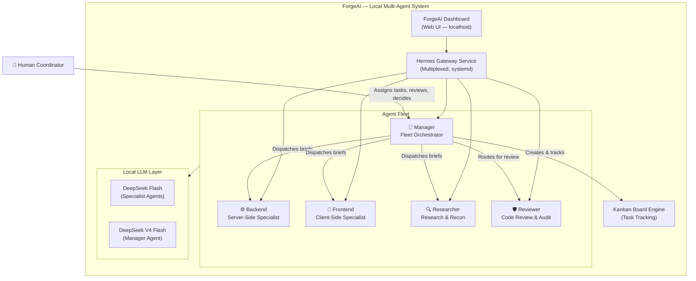

# ForgeAI — Project Documentation

> **A locally-run, multi-agent AI system where specialized AI agents collaborate on complex tasks, coordinated by a human manager through a Kanban-driven workflow.**

---

## 1. Project Overview

**ForgeAI** is a hackathon project that transforms a single developer's workstation into a fully autonomous AI engineering team. It runs entirely locally — both the agents and the LLMs — giving the user complete control, privacy, and zero cloud dependency.

The core idea is simple: instead of one AI assistant doing everything, ForgeAI deploys a **fleet of specialized agents**, each with a defined role and lane of expertise. The **human acts as the coordinator (manager)**, assigning work, reviewing progress, and making design decisions — while the agents handle the heavy execution.

### Key Principles

| Principle | Description |
|---|---|
| **100% Local** | All agents and LLMs run on the user's machine. No API keys required for core operation. |
| **Human-as-Manager** | The user coordinates the agents, not the other way around. Agents never guess — they ask. |
| **Specialization over Generalization** | Each agent owns a specific domain and stays in its lane. |
| **Kanban-Driven Orchestration** | Every multi-agent task gets a dedicated Kanban board for transparency and tracking. |
| **Evidence-Based Delivery** | No agent claims "it works" — they prove it with test output, command results, or file paths. |

---

## 2. Architecture



### How It Works

1. The **Human Coordinator** sends a task to the **Manager** agent via the dashboard, CLI, or messaging gateway.
2. The **Manager** decomposes the task, creates a **Kanban board**, and dispatches self-contained briefs to the appropriate specialist agents.
3. Each **specialist agent** executes its assigned work within its lane — writing code, researching docs, or reviewing diffs.
4. Results flow back to the **Manager**, who aggregates, verifies, and delivers the integrated output to the human.
5. The **Human** reviews the result, provides feedback, and iterates.

---

## 3. Agent Fleet

ForgeAI ships with **5 agent profiles**, each with a distinct SOUL (personality, constraints, and output contract):

### 🎯 Manager — Fleet Orchestrator

| Property | Value |
|---|---|
| **Profile** | `manager` |
| **Model** | DeepSeek V4 Flash |
| **Role** | Decomposes tasks, dispatches to specialists, aggregates results |

**Responsibilities:**
- Decides whether to answer directly or delegate to specialists
- Creates Kanban boards for every multi-agent workflow
- Writes self-contained dispatch briefs (specialists have no shared context)
- Verifies specialist output before delivering to the human
- Never fabricates specialist output

**Decision Logic:**
- *Simple questions / conceptual inquiries* → Responds directly (no Kanban)
- *Multi-file implementation / domain-specific work* → Creates Kanban board → Dispatches to specialists

---

### ⚙️ Backend — Server-Side Specialist

| Property | Value |
|---|---|
| **Profile** | `backend` |
| **Model** | DeepSeek Flash |
| **Role** | APIs, databases, business logic, auth, background jobs |

**Owns:** Server-side architecture, endpoints, database schemas, migrations, data models, query performance, authentication, service integrations.

**Does NOT own:** Client-side markup, CSS, browser behavior, build pipelines, infrastructure, code reviews.

**Working Standard:**
- Every endpoint has a clear schema, input validation, and error responses
- Data integrity is paramount — validates edge cases, concurrency, transactions
- Runs unit/integration tests or makes real HTTP calls to prove functionality
- Fails cleanly with structured error handling

---

### 🎨 Frontend — Client-Side Specialist

| Property | Value |
|---|---|
| **Profile** | `frontend` |
| **Model** | DeepSeek Flash |
| **Role** | Components, styling, client state, routing, accessibility |

**Owns:** UI markup, layout, styling, client-side state, data fetching, forms, validation, responsive behavior, browser performance.

**Does NOT own:** Server-side logic, API contracts, database work, build pipelines, research.

**Working Standard:**
- Verifies in a real browser — runs the dev server and checks actual rendering
- Checks all states: loading, empty, error, long-content, offline
- Accessibility is not optional — semantic elements, labels, keyboard navigation
- Never fabricates a screenshot or claims a visual result not observed

---

### 🔍 Researcher — Research & Reconnaissance Specialist

| Property | Value |
|---|---|
| **Profile** | `researcher` |
| **Model** | DeepSeek Flash |
| **Role** | Web search, documentation, fact-checking, codebase recon |

**Owns:** Documentation lookup, version/compatibility research, library investigation, API research, dependency analysis, fact-checking.

**Does NOT:** Write or modify production code. Hands findings to the appropriate specialist.

**Output Contract:**
- Answer first, stated directly
- Source — real URL, file path with line numbers, or doc page
- Version/relevance — which version the answer applies to
- Confidence level with reasoning
- Sharp distinction between what was *read* vs. *inferred*

---

### 🛡️ Reviewer — Code Review & Audit Specialist

| Property | Value |
|---|---|
| **Profile** | `reviewer` |
| **Model** | DeepSeek Flash |
| **Role** | Code review, security auditing, regression detection |

**Owns:** Reviewing diffs, PRs, and files for correctness, security, error handling, concurrency, resource leaks, test coverage, maintainability.

**Does NOT:** Edit code. The fix belongs to whoever owns the file. Proposing a patch in prose is fine; applying it destroys review independence.

**Output Contract:**
- Findings ordered by severity: `blocking` / `major` / `minor` / `nit`
- Each finding includes: location (`path:line`), what's wrong, why it matters, suggested fix
- States the scope reviewed and what was NOT looked at

---

## 4. Kanban Board Workflow

> **Core Invariant:** *ALWAYS create a new Kanban board whenever multiple agents work together.*

The Kanban system is the backbone of ForgeAI's multi-agent coordination. It ensures transparency, dependency tracking, and lifecycle management across the fleet.

### When to Create a Board

| Scenario | Board Required? |
|---|---|
| Manager answers a question directly | ❌ No |
| Manager + 1 specialist | ✅ Yes |
| Manager + multiple specialists | ✅ Yes |
| Any cross-domain collaboration | ✅ Yes |

### Board Lifecycle


### Commands

```bash
# Create a new board
hermes kanban boards create feature-auth

# Switch to the board
hermes kanban boards switch feature-auth

# Create a task card
hermes kanban create --title "Design REST API schema" \
  --body "Define endpoints for /auth/login, /auth/register with JWT" \
  --assignee backend

# Link dependencies (frontend blocked by backend API)
hermes kanban link <parent_id> <child_id>

# Track progress
# todo → in_progress → review → done
```

### Task Lifecycle States

```
┌──────┐    ┌─────────────┐    ┌────────┐    ┌──────┐
│ todo │───▶│ in_progress │───▶│ review │───▶│ done │
└──────┘    └─────────────┘    └────────┘    └──────┘
```

---

## 5. Running Locally

### Prerequisites

| Requirement | Details |
|---|---|
| **OS** | Linux (tested on Fedora/Ubuntu) |
| **Python** | 3.11+ |
| **Git** | For installation |
| **Local LLM** | DeepSeek Flash / V4 Flash (via Ollama, vLLM, or compatible server) |

### Installation

```bash
# 1. Clone the repository
git clone https://github.com/NousResearch/hermes-agent.git
cd hermes-agent

# 2. Activate the development environment
source ./activate

# 3. Set up your local LLM provider
hermes setup
# Follow the interactive prompts to configure your local LLM endpoint
```

### Setting Up Agent Profiles

Each agent runs as an independent Hermes profile with its own SOUL, config, and model assignment.

```bash
# Create the 12 sovereign engineering profiles + auxiliary researcher
for role in manager tech_lead backend frontend reviewer architect security qa devops database docs performance researcher; do
  hermes profile create $role
  cp agent-profiles/$role/SOUL.md ~/.hermes/profiles/$role/SOUL.md
  cp agent-profiles/$role/profile.yaml ~/.hermes/profiles/$role/config.yaml
done
```

### Configuring Local LLMs

ForgeAI is designed to run with **locally-hosted LLMs**. The current setup uses:

| Agent | Model | Purpose |
|---|---|---|
| Manager | `deepseek-v4-flash` | Higher capability for orchestration & reasoning |
| Backend | `deepseek-flash` | Fast code generation |
| Frontend | `deepseek-flash` | Fast code generation |
| Researcher | `deepseek-flash` | Fast retrieval & summarization |
| Reviewer | `deepseek-flash` | Fast code review |

Configure each profile's model in its `config.yaml`:

```yaml
# ~/.hermes/profiles/backend/config.yaml
model: deepseek-flash
```

Or set the model via CLI:

```bash
hermes -p backend model set deepseek-flash
hermes -p manager model set deepseek-v4-flash
```

### Starting the Gateway

The Hermes Gateway is a single multiplexed service that manages all agent profiles simultaneously:

```bash
# Start the gateway for all profiles
hermes gateway start

# Or restart with all profiles
hermes gateway restart --all

# Check status
hermes profile list
```

Expected output:

```
 Profile          Model                  Gateway      Alias
 ───────────────  ─────────────────────  ───────────  ──────────
  default         deepseek-flash         running      —
  backend         deepseek-flash         running      backend
  frontend        deepseek-flash         running      frontend
 ◆manager         deepseek-v4-flash      running      manager
  researcher      deepseek-flash         running      researcher
  reviewer        deepseek-flash         running      reviewer
```

### Accessing the Dashboard

Once the gateway is running, open the ForgeAI Dashboard:

```bash
hermes dashboard
# Opens at http://localhost:1618
```

The dashboard provides:
- Real-time agent session monitoring
- Kanban board visualization
- Model and tool configuration
- Analytics and token usage tracking
- Profile management

---

## 6. Usage Workflow

### Example: Building a Feature

Here's a typical workflow where the human acts as coordinator:

**Step 1 — Human assigns the task:**
```
"Build a user authentication system with JWT tokens, a login page, and code review."
```

**Step 2 — Manager creates a Kanban board and decomposes:**
```bash
hermes kanban boards create auth-system
hermes kanban boards switch auth-system
```

Board tasks:
| # | Task | Assignee | Status |
|---|---|---|---|
| 1 | Research JWT best practices | researcher | todo |
| 2 | Design & implement REST API (`/auth/*`) | backend | todo |
| 3 | Build login page UI | frontend | blocked by #2 |
| 4 | Security review of auth implementation | reviewer | blocked by #2, #3 |

**Step 3 — Manager dispatches self-contained briefs:**
```bash
# To researcher
hermes -p researcher chat -q "Research JWT authentication best practices for Node.js..."

# To backend (after researcher returns)
hermes -p backend chat -q "Implement JWT auth endpoints: POST /auth/login, POST /auth/register..."

# To frontend (after backend defines API contract)
hermes -p frontend chat -q "Build a login page that calls POST /auth/login..."

# To reviewer (after implementation is complete)
hermes -p reviewer chat -q "Review the auth implementation in /src/auth/ for security issues..."
```

**Step 4 — Human reviews the integrated result:**
The manager aggregates all outputs, presents the result with evidence (test outputs, file paths, review findings), and the human decides the next action.

---

## 7. Dispatch Protocol

Specialists have **no shared context** — every dispatch brief must be self-contained.

### Brief Structure

```
1. GOAL      — The outcome, in 1-2 sentences
2. DELIVERABLE — Exactly what to return (patch, findings, file paths)
3. INPUTS    — Absolute paths, URLs, branch, diff range
4. CONSTRAINTS — Languages, versions, conventions, files to avoid
5. EVIDENCE  — Require verifiable proof (command output, test results)
```

### Rules

- **Decompose → Board → Dispatch → Aggregate → Verify → Deliver**
- Parallelize independent briefs
- One brief per specialist per round
- Max 2 rounds per specialist — if failing, report the blocker
- Never fabricate specialist output

---

## 8. Project Structure

```
hermes-agent/
├── profiles/                    # Agent SOUL files & configs
│   ├── manager/
│   │   ├── SOUL.md              # Fleet orchestrator personality
│   │   └── config.yaml          # Model: deepseek-v4-flash
│   ├── backend/
│   │   ├── SOUL.md              # Server-side specialist
│   │   └── config.yaml          # Model: deepseek-flash
│   ├── frontend/
│   │   ├── SOUL.md              # Client-side specialist
│   │   └── config.yaml
│   ├── researcher/
│   │   ├── SOUL.md              # Research & recon specialist
│   │   └── config.yaml
│   └── reviewer/
│       ├── SOUL.md              # Code review specialist
│       └── config.yaml
├── .agents/rules/
│   └── kanban_multiagent.md     # Enforced: Kanban board for multi-agent work
├── web/                         # ForgeAI Dashboard (React + Vite)
│   ├── src/
│   │   ├── App.tsx              # Main dashboard app
│   │   ├── themes/presets.ts    # ForgeAI Black theme
│   │   └── i18n/en.ts           # Brand: "ForgeAI"
│   └── index.html               # Page title: "ForgeAI - Dashboard"
└── hermes_cli/                  # CLI, gateway, Kanban engine
```

---

## 9. Tech Stack

| Layer | Technology |
|---|---|
| **Agent Framework** | [Hermes Agent](https://github.com/NousResearch/hermes-agent) v0.21.5 |
| **Local LLMs** | DeepSeek Flash, DeepSeek V4 Flash |
| **Gateway** | Hermes Gateway (systemd user service, multiplexed) |
| **Dashboard** | React + Vite + TypeScript (ForgeAI Black theme) |
| **Task Management** | Built-in Kanban Board Engine |
| **Runtime** | Python 3.11, Node.js |
| **OS** | Linux |

---

## 10. Design Decisions

### Why Local-Only?

- **Privacy:** All code, prompts, and agent conversations stay on your machine.
- **Cost:** No per-token API billing — run as many agent cycles as your hardware supports.
- **Speed:** No network latency to cloud APIs; local inference on GPU.
- **Control:** Full control over model selection, fine-tuning, and agent behavior.

### Why Multiple Specialized Agents?

- **Better output quality:** An agent constrained to "server-side code only" writes better server code than a generalist told to "do everything."
- **Parallel execution:** Independent tasks run simultaneously across agents.
- **Review independence:** The reviewer never writes the code it reviews — separation of concerns prevents rubber-stamping.
- **Clear accountability:** When something breaks, you know exactly which agent's output to inspect.

### Why Kanban?

- **Transparency:** The human coordinator sees exactly what each agent is working on.
- **Dependency tracking:** Frontend work is explicitly blocked until backend delivers the API contract.
- **Audit trail:** Every task has acceptance criteria, lifecycle state, and evidence attached.
- **No silent failures:** Agents can't quietly drop work — it's tracked on the board.

### Why Human-as-Manager?

- **Design decisions stay human:** Architecture choices, trade-offs, and priorities are human calls.
- **Quality gate:** The human reviews integrated output before it ships.
- **Context the agents lack:** Business requirements, user needs, and organizational constraints live with the human.
- **Trust but verify:** Agents execute; humans validate.

---

## 11. Future Roadmap

- [ ] Additional specialist agents (DevOps, QA, Designer)
- [ ] Auto-scaling agent count based on task complexity
- [ ] Voice-based task dispatch and status updates
- [ ] Persistent memory across sessions for learning team patterns
- [ ] Integration with GitHub Issues / Linear for external project management
- [ ] Support for additional local LLM providers (llama.cpp, Mistral, etc.)

---

## 12. Quick Reference

```bash
# Start everything
hermes gateway restart --all

# Open the dashboard
hermes dashboard

# Dispatch a task to an agent
hermes -p backend chat -q "Your brief here..."

# Create a Kanban board
hermes kanban boards create my-feature

# Check agent status
hermes profile list

# View agent logs
hermes logs --follow
```

---

**ForgeAI** — Your local AI engineering team. You lead. They build.
